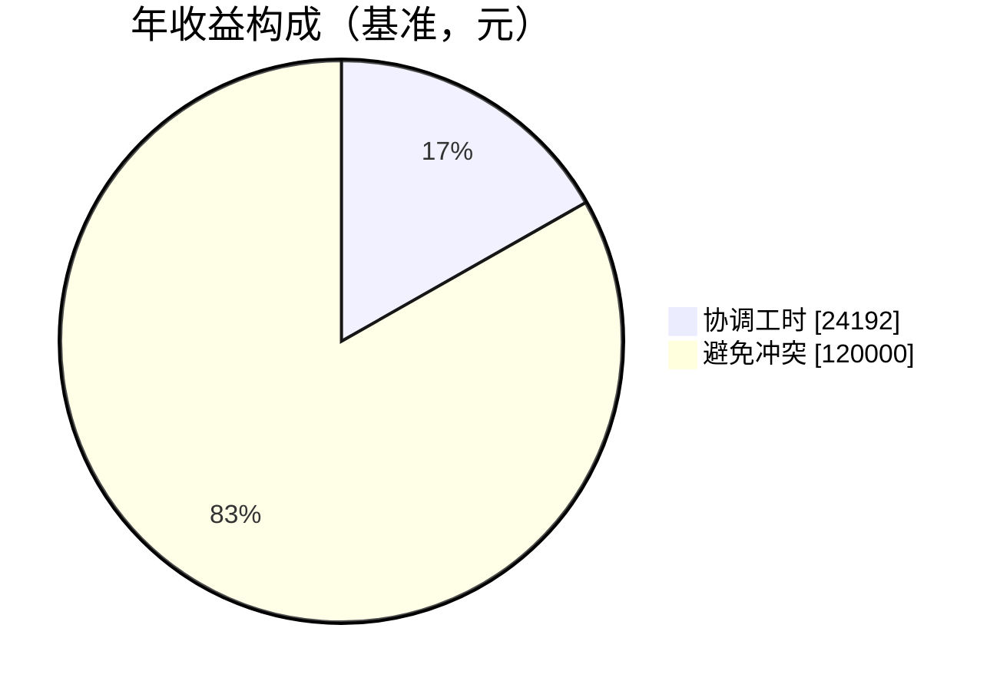
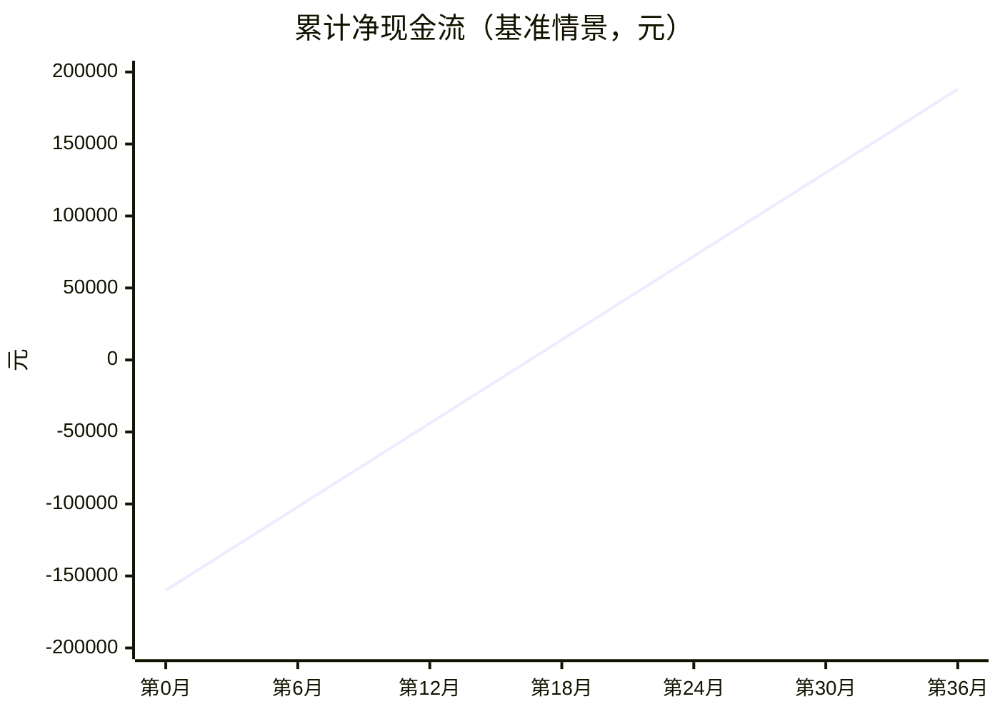

# 华衡智造 · 订单变更影响核对助手 —— 企业报价包

按《FDE 企业报价与 ROI 测算》课件口径制作，数字由 [`tools/build_pricing.ps1`](tools/build_pricing.ps1) 一次算出，各表可以互相复算。带公式的 Excel 版见 [`华衡智造-企业报价包.xlsx`](华衡智造-企业报价包.xlsx)，口径、假设清单与数字咬合校验见 [`README.md`](README.md)。

> 华衡是合成业务现场，标“假设”的输入不是事实；签约前须由客户提供基线数据后重算。金额除注明外均为元。

## 0 项目一页纸

| 要填的五项 | 华衡智造 · 订单变更影响核对助手（本项目） | 填写依据 / 待确认 |
| --- | --- | --- |
| 客户是谁 | 华衡智造（制造企业，规模未在案例中给出，按约 300 人中型制造企业假设）；总经理周明远出资，生产计划部牵头使用 | 访谈：问题由销售总监提出，生产计划经理为主要用户；规模为假设 |
| 多少人用 | 约 7 人：生产计划 2、客户服务 3、销售 1、质量 1 | 案例出现 6 个角色，各岗位人数为假设 |
| 每天多少量 | 客服日均约 45 条变更咨询；核对报告按月 40 份（约 1.3 份/日） | 45 条为客服主管陈述；月 40 单为假设，与阶段 04 的 N=40 一致 |
| 数据在哪 | ERP、MES、WMS、QMS 均在内网，仅提供脱敏 CSV 或只读快照，不提供写接口 | 访谈事实：四系统只给脱敏快照 |
| 能不能上云 | 核心核对不上云（纯规则，内网运行）；仅“报告说明文字”脱敏后调云端 API，须信息化负责人确认，未确认则回退固定模板 | 待确认项；见 04 部署方案对比表 |

## 1 成本拆解表（含人天估算与报价）

| 成本拆解表 | 明细项 | 角色 | 天数 | 单价(元) | 测算依据 | 金额(元) | 计费周期 | 备注 |
| --- | --- | --- | --- | --- | --- | --- | --- | --- |
| 人力 | 需求调研与方案设计：业务调研与角色访谈（6 个角色 × 1 轮） | FDE 工程师 | 4 | 1,960 | 人天综合成本 = 月薪 × 1.55 ÷ 21.75 ÷ 0.8（02 表）；4 天 × 1960 | 7,840 | 首年（一次性） | 总经理、销售、生产计划、信息化、质量、客服 |
| 人力 | 需求调研与方案设计：现状流程还原与四来源口径收敛 | 产品经理 | 2 | 1,603 | 2 天 × 1603 | 3,206 | 首年（一次性） | 交付率两套口径先锁定 |
| 人力 | 需求调研与方案设计：需求规格、追溯矩阵与验收指标 | 产品经理 | 3 | 1,603 | 3 天 × 1603 | 4,809 | 首年（一次性） | 含停止条件与试点范围 |
| 人力 | 需求调研与方案设计：方案设计与备选比较 | 解决方案架构师 | 2 | 2,672 | 2 天 × 2672 | 5,344 | 首年（一次性） | 含安全边界与人工关卡设计 |
| 人力 | 知识库/规则库构建：核对规则实现 ×4（版本一致性、质量冻结、产能缺口、待确认清单） | FDE 工程师 | 8 | 1,960 | 8 天 × 1960 | 15,680 | 首年（一次性） | 确定性规则，核对结论不依赖模型 |
| 人力 | 核对流程开发（按流程条数拆）：报告说明生成 ×1（模型调用、提示词、输出约束、回退模板） | FDE 工程师 | 3 | 1,960 | 3 天 × 1960 | 5,880 | 首年（一次性） | 模型只解释已有结果，不参与判定 |
| 人力 | 系统对接（按接口个数拆）：四系统快照接入与字段口径对齐 ×4（ERP / MES / WMS / QMS） | 后端工程师 | 6 | 1,425 | 6 天 × 1425 | 8,550 | 首年（一次性） | 只读快照，不含写接口 |
| 人力 | 系统对接（按接口个数拆）：审计留痕与任务编号绑定 | 后端工程师 | 2 | 1,425 | 2 天 × 1425 | 2,850 | 首年（一次性） | 每次核对可追溯 |
| 人力 | 系统对接（按接口个数拆）：报告输出（Markdown / JSON）与命令行入口 | 后端工程师 | 2 | 1,425 | 2 天 × 1425 | 2,850 | 首年（一次性） |  |
| 人力 | 集成联调（单独列）：真实快照字段口径联调 | 后端工程师 | 3 | 1,425 | 3 天 × 1425 | 4,275 | 首年（一次性） | 约占开发量 20%–30% |
| 人力 | 集成联调（单独列）：业务复核联调（与生产计划、客服逐单比对） | FDE 工程师 | 2 | 1,960 | 2 天 × 1960 | 3,920 | 首年（一次性） |  |
| 人力 | 测试评估：评估集构建（17 个用例，先写预期） | 测试/实施工程师 | 3 | 1,069 | 3 天 × 1069 | 3,207 | 首年（一次性） | 预期结论先于运行写定 |
| 人力 | 测试评估：单元测试与红线测试（只读、审计、转人工） | 测试/实施工程师 | 2 | 1,069 | 2 天 × 1069 | 2,138 | 首年（一次性） |  |
| 人力 | 测试评估：红线评审与质量复核 | 解决方案架构师 | 1 | 2,672 | 1 天 × 2672 | 2,672 | 首年（一次性） | 质量负责人参与 |
| 人力 | 效果调优（含 2 轮）：规则口径调优（2 轮，每轮 1 天） | FDE 工程师 | 2 | 1,960 | 2 天 × 1960 | 3,920 | 首年（一次性） | 超出 2 轮按人天另计 |
| 人力 | 试点与交接：试点运行支持（4 周，每周运行与复盘） | 测试/实施工程师 | 4 | 1,069 | 4 天 × 1069 | 4,276 | 首年（一次性） |  |
| 人力 | 试点与交接：培训与交接材料（运维手册、培训） | FDE 工程师 | 2 | 1,960 | 2 天 × 1960 | 3,920 | 首年（一次性） |  |
| 人力 | 试点与交接：上线检查与放行门禁评审 | 解决方案架构师 | 1 | 2,672 | 1 天 × 2672 | 2,672 | 首年（一次性） | 生产计划、质量、信息化三方 |
| 人力 | 整体缓冲 20% | 按加权单价 | 10 | 1,692 | 52 人天 × 20% = 10 人天 | 16,920 | 首年（一次性） | 含联调与调优，不摊入各工作包 |
| 人力 | 人力小计 |  | 62 |  | 工作包 52 人天 + 缓冲 10 人天（成本口径） | 104,929 | 首年（一次性） | 联调 5 人天，占开发量 24% |
| 模型 | 报告说明生成（DeepSeek Flash，离峰价） |  |  |  | 03 表基准档 0.31 元/月 × 12 | 3.70 | 首年起每年 | 核对结论不调用模型 |
| 模型 | 用量缓冲 20% |  |  |  | 包干量含 20% 用量缓冲，超量按单价结算 | 0.74 | 首年起每年 |  |
| 服务器 | 开发测试环境 |  |  |  | 云主机 2 核 4G 约 120 元/月（假设）× 3 个月 | 360 | 首年（一次性） | 待按云平台实时报价复核 |
| 服务器 | 生产运行环境 |  |  |  | 核对程序仅用标准库 Python，部署在客户内网现有虚拟机（客户自备） | 0 | — | 无 GPU、无云租 |
| 数据 | 脱敏快照导出与字段口径对齐 |  |  |  | 已含在人力“四系统快照接入 ×4”（6 人天），不重复计 | 0 | — | 数据块逐项列示，避免漏算 |
| 数据 | 第三方接口（发票查验、行业数据等） |  |  |  | 本项目不涉及 | 0 | — |  |
| 运维 | 日常响应与巡检 | FDE 工程师 | 6 | 1,960 | 0.5 人天/月 × 12 个月 × 1960 | 11,760 | 首年起每年 |  |
| 运维 | 版本迭代 | FDE 工程师 | 4 | 1,960 | 4 人天/年 × 1960 | 7,840 | 首年起每年 |  |
| 实施差旅 | 现场调研、试点复盘 |  |  |  | 4 次 × 1,500 元（假设） | 6,000 | 首年（一次性） |  |
| 合计 | 首年成本合计（成本口径） |  |  |  | 人力 + 模型 + 服务器 + 数据 + 运维 + 差旅，逐项加总 | 130893.44 | 首年 |  |
| 合计 | 续年成本合计（成本口径） |  |  |  | 运维 + 模型 | 19604.44 | 续年每年 |  |
| 对外报价 | 一次性实施费 |  | 62 |  | 成本 111,289 × (1 + 15%) × (1 + 25%) | 159,978 | 首年（一次性） | 对外人天单价已含 25% 加成，故以成本口径为基数只加成一次 |
| 对外报价 | 年服务费 |  |  |  | 成本 19604.44 × (1 + 15%) × (1 + 25%) | 28,181 | 首年及续年每年 | 含运维 10 人天/年与模型用量包 |
| 对外报价 | 首年合计 |  |  |  | 实施费 + 年服务费 | 188,159 | 首年 | 续年 = 年服务费 28181 |
| 报价模式 | 组合报价：一次性实施费 + 年服务费 + 超量按单价 |  |  |  |  |  |  | 四选一取“项目总价制 + 订阅制”的组合 |
| 选择理由(一句话) | 范围与验收标准清晰（17 个评估用例、只读核对），适合固定价交付；模型与运维成本按年发生，用年服务费覆盖，用量超包另计。 |  |  |  |  |  |  |  |

## 2 人天估算与单价表

**工作包**

| 阶段（工作包类别） | 序号 | 工作包（可计数） | 角色 | 天数 | 单价-成本口径(元) | 单价-对外口径(元) | 小计-成本口径(元) | 小计-对外口径(元) | 说明 |
| --- | --- | --- | --- | --- | --- | --- | --- | --- | --- |
| 需求调研与方案设计 | 1 | 业务调研与角色访谈（6 个角色 × 1 轮） | FDE 工程师 | 4 | 1,960 | 2,450 | 7,840 | 9,800 | 总经理、销售、生产计划、信息化、质量、客服 |
| 需求调研与方案设计 | 2 | 现状流程还原与四来源口径收敛 | 产品经理 | 2 | 1,603 | 2,004 | 3,206 | 4,008 | 交付率两套口径先锁定 |
| 需求调研与方案设计 | 3 | 需求规格、追溯矩阵与验收指标 | 产品经理 | 3 | 1,603 | 2,004 | 4,809 | 6,012 | 含停止条件与试点范围 |
| 需求调研与方案设计 | 4 | 方案设计与备选比较 | 解决方案架构师 | 2 | 2,672 | 3,340 | 5,344 | 6,680 | 含安全边界与人工关卡设计 |
| 知识库/规则库构建 | 5 | 核对规则实现 ×4（版本一致性、质量冻结、产能缺口、待确认清单） | FDE 工程师 | 8 | 1,960 | 2,450 | 15,680 | 19,600 | 确定性规则，核对结论不依赖模型 |
| 核对流程开发（按流程条数拆） | 6 | 报告说明生成 ×1（模型调用、提示词、输出约束、回退模板） | FDE 工程师 | 3 | 1,960 | 2,450 | 5,880 | 7,350 | 模型只解释已有结果，不参与判定 |
| 系统对接（按接口个数拆） | 7 | 四系统快照接入与字段口径对齐 ×4（ERP / MES / WMS / QMS） | 后端工程师 | 6 | 1,425 | 1,781 | 8,550 | 10,686 | 只读快照，不含写接口 |
| 系统对接（按接口个数拆） | 8 | 审计留痕与任务编号绑定 | 后端工程师 | 2 | 1,425 | 1,781 | 2,850 | 3,562 | 每次核对可追溯 |
| 系统对接（按接口个数拆） | 9 | 报告输出（Markdown / JSON）与命令行入口 | 后端工程师 | 2 | 1,425 | 1,781 | 2,850 | 3,562 |  |
| 集成联调（单独列） | 10 | 真实快照字段口径联调 | 后端工程师 | 3 | 1,425 | 1,781 | 4,275 | 5,343 | 约占开发量 20%–30% |
| 集成联调（单独列） | 11 | 业务复核联调（与生产计划、客服逐单比对） | FDE 工程师 | 2 | 1,960 | 2,450 | 3,920 | 4,900 |  |
| 测试评估 | 12 | 评估集构建（17 个用例，先写预期） | 测试/实施工程师 | 3 | 1,069 | 1,336 | 3,207 | 4,008 | 预期结论先于运行写定 |
| 测试评估 | 13 | 单元测试与红线测试（只读、审计、转人工） | 测试/实施工程师 | 2 | 1,069 | 1,336 | 2,138 | 2,672 |  |
| 测试评估 | 14 | 红线评审与质量复核 | 解决方案架构师 | 1 | 2,672 | 3,340 | 2,672 | 3,340 | 质量负责人参与 |
| 效果调优（含 2 轮） | 15 | 规则口径调优（2 轮，每轮 1 天） | FDE 工程师 | 2 | 1,960 | 2,450 | 3,920 | 4,900 | 超出 2 轮按人天另计 |
| 试点与交接 | 16 | 试点运行支持（4 周，每周运行与复盘） | 测试/实施工程师 | 4 | 1,069 | 1,336 | 4,276 | 5,344 |  |
| 试点与交接 | 17 | 培训与交接材料（运维手册、培训） | FDE 工程师 | 2 | 1,960 | 2,450 | 3,920 | 4,900 |  |
| 试点与交接 | 18 | 上线检查与放行门禁评审 | 解决方案架构师 | 1 | 2,672 | 3,340 | 2,672 | 3,340 | 生产计划、质量、信息化三方 |
| 小计 |  | 18 个工作包 |  | 52 | 1,692 | 2,116 | 88,009 | 110,007 | 加权平均单价 = 小计 ÷ 52 人天 |
| 整体缓冲 | 19 | 整体缓冲 20% | 按加权单价 | 10 | 1,692 | 2,116 | 16,920 | 21,160 | 需求侧尚有 6 项缺口未关闭，取 15%–25% 区间中值；不摊入各工作包 |
| 合计 |  | 含缓冲 |  | 62 |  |  | 104,929 | 131,167 | 报价以成本口径为基数，风险预留与加成各乘一次（见 01 表） |
**单价推导**

| 角色 | 月薪(元) | 综合成本系数 | 可计费利用率(%) | 成本加成率(%) | 月综合成本(元) | 人天综合成本(元) | 对外人天单价(元) | 课程参考区间(元) |
| --- | --- | --- | --- | --- | --- | --- | --- | --- |
| 解决方案架构师 | 30,000 | 1.55 | 80 | 25 | 46,500 | 2,672 | 3,340 | 2,500–3,500 |
| FDE 工程师 | 22,000 | 1.55 | 80 | 25 | 34,100 | 1,960 | 2,450 | 1,800–2,500 |
| 产品经理 | 18,000 | 1.55 | 80 | 25 | 27,900 | 1,603 | 2,004 | 1,800–2,500 |
| 后端工程师 | 16,000 | 1.55 | 80 | 25 | 24,800 | 1,425 | 1,781 | 1,500–2,200 |
| 测试/实施工程师 | 12,000 | 1.55 | 80 | 25 | 18,600 | 1,069 | 1,336 | 1,200–1,800 |
| 算法工程师 | 不列 |  |  |  |  |  |  | 2,000–3,000 |

> 说明：人天综合成本 = 月薪 × 综合成本系数 ÷ 21.75 ÷ 利用率；对外人天单价 = 人天综合成本 × (1 + 成本加成率)。FDE 一行与测算器导出结果一致（1,960 / 2,450）。本项目不涉及模型微调，故不列算法工程师。

## 3 Token 月成本测算表

**单次输入构成**

| 构成项 | Token | 说明 |
| --- | --- | --- |
| 系统提示词（角色、约束、输出格式） | 1,200 | 固定前缀，可命中缓存 |
| 结构化核对结果（已确认 / 发现 / 待审批清单） | 1,500 | 规则引擎输出，已脱敏 |
| 规则说明与事实依据 | 800 | 规则版本 1.0.0 的条文摘录 |
| 订单号与本次指令 | 100 |  |
| 历史对话 | 0 | 单次调用，不携带历史 |
| 工具返回结果 | 0 | 已包含在结构化核对结果内 |
| 单次输入合计 | 3,600 | 估算值，上线前用真实报告样本按分词器实测后重算 |
| 单次输出 | 800 | 约 1,000 字中文说明 |
**三档测算**

| 档位 | 模型 | 计价口径 | 日均请求数(次) | 月请求数(次) | 单次输入Token | 单次输出Token | Agent步数 | 重试率(%) | 输入缓存命中率(%) | 输入单价(元/百万Token) | 输出单价(元/百万Token) | 单次请求成本(元) | 月成本(元) | 年成本(元) | 月Token总量 |
| --- | --- | --- | --- | --- | --- | --- | --- | --- | --- | --- | --- | --- | --- | --- | --- |
| 保守 | DeepSeek deepseek-flash | 业务量 ×0.7 | 1.33333333333333 | 28.00 | 3,600 | 800 | 1 | 5 | 0 | 1.08 | 4.32 | 0.0077 | 0.22 | 2.59 | 123,200 |
| 基准 | DeepSeek deepseek-flash | 业务量 ×1.0 | 1.33333333333333 | 40.00 | 3,600 | 800 | 1 | 5 | 0 | 1.08 | 4.32 | 0.0077 | 0.31 | 3.70 | 176,000 |
| 高峰 | DeepSeek deepseek-flash | 业务量 ×1.6 | 1.33333333333333 | 64.00 | 3,600 | 800 | 1 | 5 | 0 | 1.08 | 4.32 | 0.0077 | 0.49 | 5.92 | 281,600 |

> 说明：单次请求成本 = (输入 × 输入单价 + 输出 × 输出单价) × Agent 步数 × (1 + 重试率)；月成本 = 单次请求成本 × 日均请求数 × 30；年成本 = 月成本 × 12。基准档年成本即 06 报价汇总表里的模型费。价格为课件口径（2026-11-26 核验）的离峰价，高峰时段 ×2。

## 4 部署方案对比表与推荐配置单

**三方案对比**

| 方案 | 说明文字怎么生成 | 数据是否出内网 | 业务假设 | 成本构成 | 年成本(元) | 三年成本(元) | 优点 | 不选的原因 |
| --- | --- | --- | --- | --- | --- | --- | --- | --- |
| 一、云端 API（推荐） | 全部报告调 DeepSeek Flash 生成 | 脱敏后出内网（待确认） | 月 40 份报告；上下文约 4.4K Token；无并发压力 | 纯 Token 费，无固定成本 | 3.70 | 11.10 | 固定成本为零，零运维，模型质量随厂商升级 | 依赖“脱敏后可出内网”这一前提，须信息化负责人书面确认 |
| 二、本地自建 | 内网部署 7B 开源模型（INT8）生成 | 不出内网 | 峰值并发 2 路；上下文 8K；单卡 RTX 4090 24G | 自购工作站 25000 元按 3 年折旧 + 年电费 + 运维 12000 元/年；部署 5 人天 | 26220.05 | 88460.16 | 数据不出内网，断网可用 | 年固定成本约为 API 方案的七千倍，而实际月 Token 量仅为盈亏平衡点的 0.01% |
| 三、混合 | 固定模板为底，仅“冲突 / 需审批”类报告（约 30%）调 API | 仅该 30% 脱敏后出内网 | 同方案一 | API 费用 × 30% | 1.11 | 3.33 | 成本最低，API 故障时仍能出报告 | 多数报告的可读性不如模型生成；适合作为方案一未获确认时的过渡 |
| 盈亏平衡点 | 自建月固定成本 2,185 元 ÷ API 综合单价 1.67 元/百万 Token ≈ 13.1 亿 Token/月 |  | 本项目实际用量约 176,000 Token/月，远低于临界值 |  |  |  |  | 低于临界用量调 API 更便宜；高于才轮到自建，且还要先过合规与运维能力两关 |
**推荐配置单**

| 项目 | 配置 | 测算依据 |
| --- | --- | --- |
| 推荐方案 | 方案一：云端 API | 数据脱敏后可出内网时采用；未确认前按方案三（固定模板）交付，确认后开通 |
| 核对程序运行环境 | 客户内网虚拟机 4 核 8G（或任意可运行 Python 3.10+ 的机器）×1 | 纯标准库 Python，单次核对秒级完成，无并发压力；客户自备 |
| 模型 | DeepSeek deepseek-flash（云端 API） | 输入 1.08 / 输出 4.32 元每百万 Token（离峰价），高峰 ×2 |
| 显存需求 | 不适用（不部署本地模型） | 推荐方案无 GPU |
| 备选：内网 7B 模型（数据不可出内网时） | 单卡 RTX 4090 24G ×1；系统内存 32G；存储 1TB SSD | 权重 7 GB（7B × INT8 1 字节）+ KV Cache 0.92 GB（56 KB × 8192 × 2 路）= 7.92 GB，× 1.15 开销 ≈ 9.11 GB，单卡 24G 可承载 |
| 备选：网络与冗余 | 单机版；高可用需第二台同配置机器 | 月 40 份报告的用量不需要高可用 |
| 用量包 | 月均 40 次请求、约 176,000 Token 内，包干含 20% 缓冲 | 03 表基准档 × 1.2；超量按实测 Token 单价结算 |

## 5 客户 ROI 一页纸

| 类别 | 项目 | 计算式 | 数值 | 单位 | 数据来源与假设 |
| --- | --- | --- | --- | --- | --- |
| 投入 | 一次性投入（实施费） | 06 报价汇总表 | 159,978 | 元 | 报价单总价 |
| 投入 | 年运行成本（年服务费） | 06 报价汇总表 | 28,181 | 元/年 | 含运维与模型用量包 |
| 投入 | 首年总投入 | 一次性投入 + 年运行成本 | 188,159 | 元 |  |
| 收益 1 协调工时 | 每单协调工时（变更前） | 销售 0.75 + 计划 1.0 + 客服 0.5 + 工厂 0.25 小时 | 2.5 | 小时/单 | 假设：访谈有“反复向计划、客服、工厂确认”“同单至少追问两轮”“最花时间是判断版本与核对产能”的陈述，但没有逐环节耗时记录 |
| 收益 1 协调工时 | 工时压降比例 | 核对由助手完成后，人工只做复核 | 60 | % | 假设：试点期实测后更新 |
| 收益 1 协调工时 | 每月节省工时 | 40 单 × 2.5 小时 × 60% | 60.00 | 小时/月 | 约合 0.36 个全职人力 |
| 收益 1 协调工时 | 节省工时占比 | 每月节省工时 ÷（6 人 × 2000 小时/年 ÷ 12） | 6.0 | % | 受影响 6 人为假设 |
| 收益 1 协调工时 | 综合时薪 | 月薪 8,000 × 12 × 1.4 ÷ 2000 | 67.20 | 元/小时 | 月薪为假设；用综合成本，不用月薪 |
| 收益 1 协调工时 | 协调工时收益（已乘转化系数 0.5） | 每月节省工时 × 12 × 综合时薪 × 0.5 | 24,192 | 元/年 | 等效人力口径，不等于裁人 |
| 收益 2 产能与时效 | ERP 录入延迟、缺口显式化 | 不折钱 | 0 | 元/年 | 35 分钟延迟与 100 件缺口有访谈依据，但量化不成金额，只写时效改善 |
| 收益 3 避免冲突 | 年版本冲突次数 | 现场按旧版做的事件 | 12 | 次/年 | 假设：案例主题就是“客户改了订单，现场还在按旧版做”，但没有历史次数 |
| 收益 3 避免冲突 | 单次冲突损失 | 返工工时 + 材料报废 + 急单加班 + 客户补偿 | 20,000 | 元/次 | 假设：按 1,000 件级订单估，签约前须向客户索取返工与补偿记录 |
| 收益 3 避免冲突 | 冲突降低比例 | 版本、产能、质量三道核对后 | 50 | % | 假设 |
| 收益 3 避免冲突 | 避免损失收益 | 12 次/年 × 20,000 元 × 50% | 120,000 | 元/年 | 年收益的大头，也是最需要客户数据坐实的一项 |
| 收益 4 收入增量 | 不计 | — | 0 | 元/年 | 无法验证，不计入 |
| 结果 | 年收益合计（基准） | 人力节省 + 差错减少 | 144,192 | 元/年 |  |
| 结果 | 年净收益 | 年收益 − 年运行成本 | 116,011 | 元/年 |  |
| 结果 | 首年 ROI | (年收益 − 首年总投入) ÷ 首年总投入 | -23.4% |  |  |
| 结果 | 回本周期（课程公式） | 首年总投入 ÷（年收益 ÷ 12） | 15.7 | 月 | 按年收益（未扣运行成本）摊回 |
| 结果 | 回本点（净现金流口径） | 一次性投入 ÷ 月净收益 | 16.5 | 月 | 回本曲线穿过 0 的月份，比课程公式晚约 2 个月 |
| 结果 | 三年 ROI | (3 年收益 − 3 年总成本) ÷ 3 年总成本 | 76.9% |  |  |
| 结果 | 续年投入产出比 | 年收益 ÷ 年运行成本 | 5.1 倍 |  | 首年之后每年只付年服务费，这是客户每年实际看到的账 |
| 敏感性 | 保守（收益 −30%）：首年 ROI / 回本 / 三年 ROI |  | -46.4% / 22.4 个月 / 23.8% |  | 回本为课程公式口径 |
| 敏感性 | 基准：首年 ROI / 回本 / 三年 ROI |  | -23.4% / 15.7 个月 / 76.9% |  |  |
| 敏感性 | 乐观（收益 +30%）：首年 ROI / 回本 / 三年 ROI |  | -0.4% / 12.0 个月 / 130.0% |  |  |
| 敏感性 | 仅工时口径（不计避免冲突）：年净收益 | 24192 − 28,181 | -3,989 | 元/年 | 年净收益为负、不回本——与阶段 04 的结论一致：只算工时撑不起这个报价 |
| 回本曲线 | 第 0 月末累计净现金流 | −159,978 + 9,668 × 0 | -159,978 | 元 | 基准情景 |
| 回本曲线 | 第 6 月末累计净现金流 | −159,978 + 9,668 × 6 | -101,973 | 元 | 基准情景 |
| 回本曲线 | 第 12 月末累计净现金流 | −159,978 + 9,668 × 12 | -43,967 | 元 | 基准情景 |
| 回本曲线 | 第 18 月末累计净现金流 | −159,978 + 9,668 × 18 | 14,039 | 元 | 基准情景 |
| 回本曲线 | 第 24 月末累计净现金流 | −159,978 + 9,668 × 24 | 72,044 | 元 | 基准情景 |
| 回本曲线 | 第 30 月末累计净现金流 | −159,978 + 9,668 × 30 | 130,050 | 元 | 基准情景 |
| 回本曲线 | 第 36 月末累计净现金流 | −159,978 + 9,668 × 36 | 188,055 | 元 | 基准情景 |
| 回本前提 | 首年回本所需年收益 | 首年总投入 | 188,159 | 元/年 | 下面四行回答：要么业务量够大，要么冲突损失够大，二者有其一即可首年回本 |
| 回本前提 | 仅靠工时：每月需节省工时 | 首年回本所需年收益 ÷ 12 ÷（综合时薪 × 0.5） | 467 | 小时/月 | 现假设 60 小时/月 |
| 回本前提 | 仅靠工时：对应月单量 | 每月需节省工时 ÷（每单协调工时 × 压降比例） | 311 | 单/月 | 现假设 40 单/月；客服日均 45 条咨询若多数是改单，真实单量可能远高于此，须抽样核实 |
| 回本前提 | 仅靠避免冲突：对应单次冲突损失 | 首年回本所需年收益 ÷（年冲突次数 × 降低比例） | 31,360 | 元/次 | 现假设 20,000 元/次 |
| 回本前提 | 仅靠避免冲突：对应年冲突次数 | 首年回本所需年收益 ÷（单次冲突损失 × 降低比例） | 18.8 | 次/年 | 现假设 12 次/年 |

## 6 报价汇总表

| 序号 | 项目 | 说明 | 金额(元) | 计费周期 |
| --- | --- | --- | --- | --- |
| 1 | 需求调研与方案设计 | 业务流程梳理、需求规格、验收指标、ROI 测算报告 | 含在实施费 | — |
| 2 | 系统开发与集成（一次性实施费） | 62 人天（52 人天工作包 + 20% 缓冲）+ 开发测试环境 + 差旅；成本 × (1 + 15%) × (1 + 25%) | 159,978 | 首年（一次性） |
| 3 | 年服务费 | 运维 10 人天/年 + 模型用量包（月均 40 次、约 176,000 Token 内，含 20% 缓冲），超量按实测 Token 单价结算 | 28,181 | 首年及续年每年 |
| 4 | 可选：内网 7B 模型部署 | 数据不可出内网时启用：追加 5 人天 + 单卡工作站，详见 04 部署方案对比表 | 另行报价 | — |
|  | 首年合计 | 2 + 3 | 188,159 | 首年 |
|  | 续年合计 | 3 | 28,181 | 续年每年 |
| 付款节点 | 签约 40% / 上线 40% / 验收 20% | 针对一次性实施费；年服务费按年预付 |  |  |
| SLA | 工作日 4 小时内响应；结论错误 1 个工作日内修复 | 工具为内网离线运行，不承诺在线可用性，承诺每次核对产出审计清单 |  |  |
| 超出范围另计 | 新增系统对接 3 人天/系统起；超出 2 轮的调优按 2,450 元/天；ERP / MES 写接口开发不在范围 |  |  |  |
